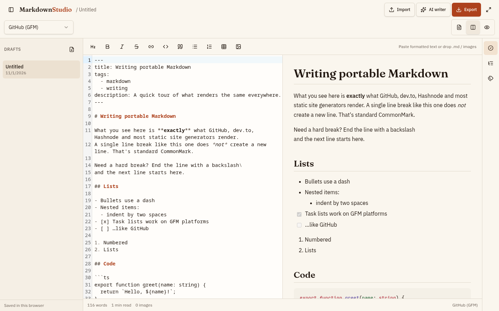
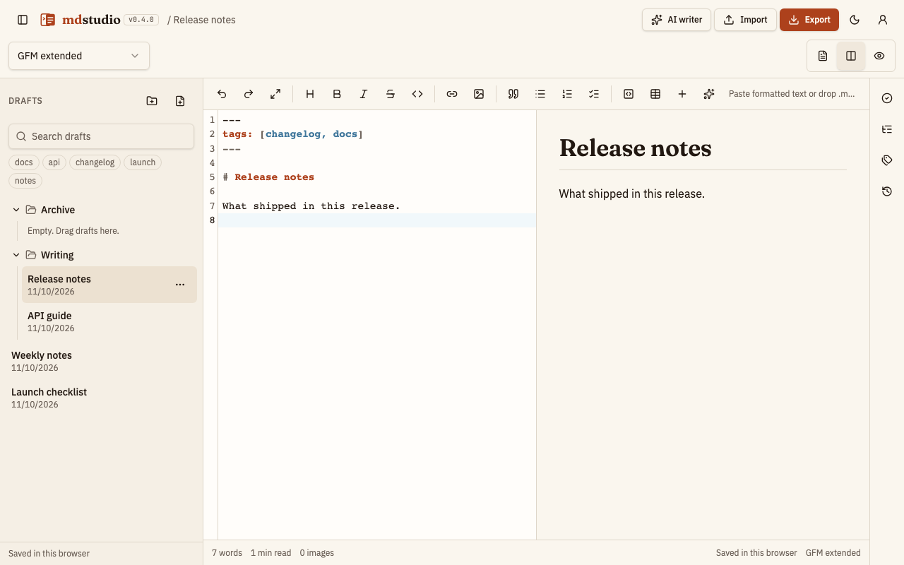
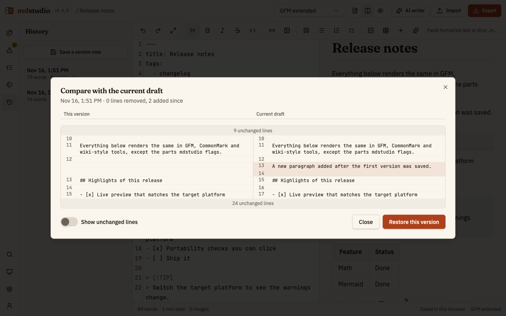
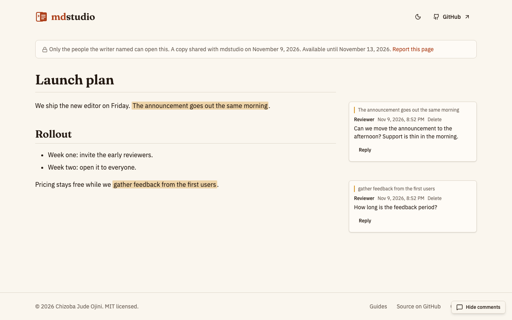
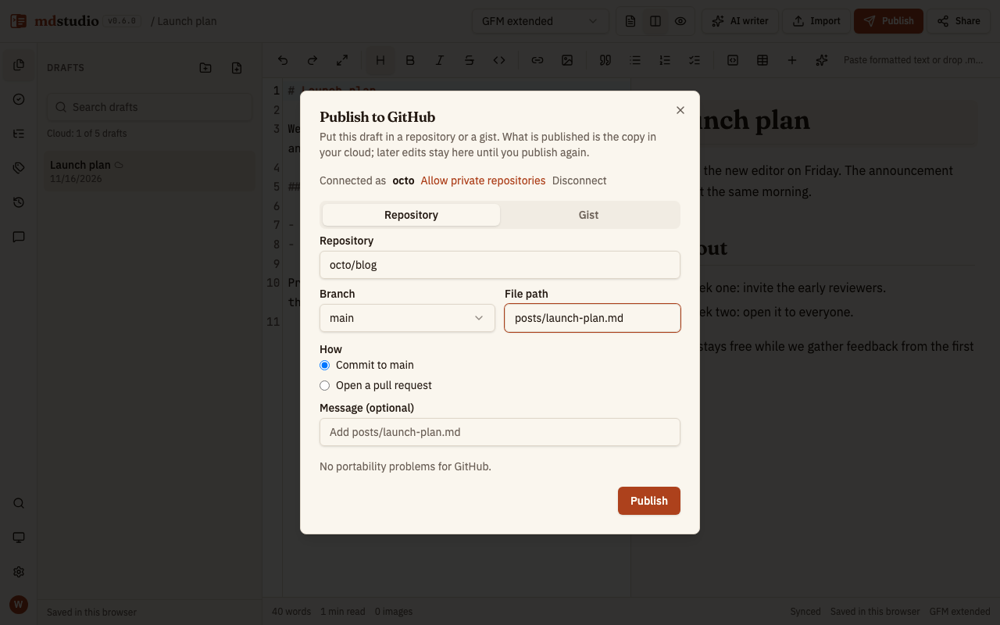
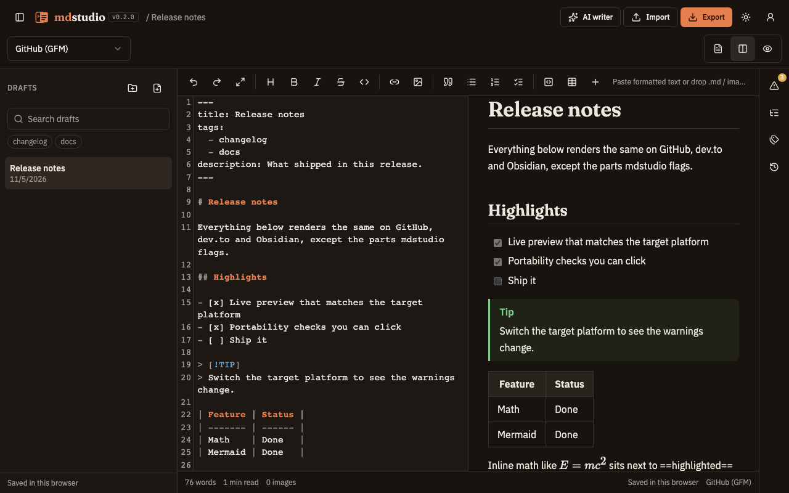
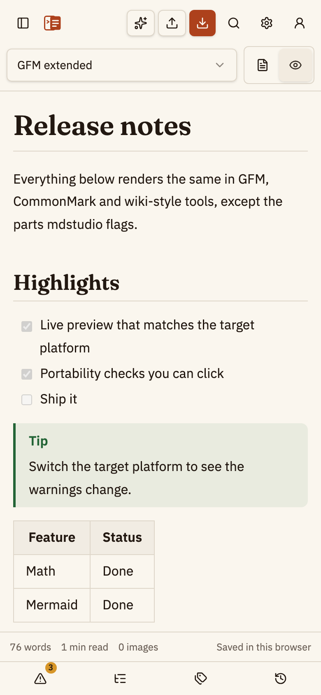

<p align="center">
  
</p>

<h1 align="center">mdstudio</h1>

<p align="center">
  <strong>Write Markdown once. See exactly how it renders everywhere.</strong><br>
  An open-source, local-first Markdown editor with a faithful live preview and a portability checker for GitHub, dev.to and Obsidian.
</p>

<p align="center">
  <a href="https://github.com/Deityhub/mdstudio/actions/workflows/ci.yml"></a>
  <a href="LICENSE"></a>
  <a href="https://mdstudio.deityhub.com"></a>
</p>

<p align="center">
  
</p>

## Why mdstudio

Most Markdown editors render your text their own way. A post can look right in the editor and break where you publish it: raw HTML gets stripped, a local image path points nowhere, `[[wiki-links]]` print literally, math and diagrams don't render.

mdstudio keeps your **raw Markdown as the single source of truth**. The preview shows what the platform you picked will render, with no preview-only tricks (no synthetic line breaks, no smart quotes), and a checker flags every spot that will look different, with a click to jump to it.

## Features

- **Faithful live preview.** Strict CommonMark and GitHub Flavored Markdown, sanitized, with syntax-highlighted code. Scrolling stays aligned line by line, and clicking a block in the preview puts the editor cursor on its source line.
- **Portability checker.** Raw HTML, local images and links, base64 images, wiki-links, `==highlights==`, math, Mermaid, trailing-space line breaks, missing alt text, unclosed tags and more. Every issue is clickable. Turn rules on or off, add publication standards (title and description length, required front matter, heading structure) and your own text or regex rules, and share them as a JSON file.
- **Target profiles.** Strict CommonMark, GitHub, dev.to / Hashnode and Obsidian. The preview, the checks and the toolbar warnings follow your choice.
- **Complete formatting toolbar.** Marks, headings, lists, task lists, links, images, footnotes, rules, code blocks, tables with cell navigation, GitHub alerts, math, diagrams and HTML helpers. Fully keyboard accessible.
- **Math and diagrams.** KaTeX and Mermaid, rendered on demand, themed for light and dark.
- **Local-first and private.** Drafts autosave to your browser's IndexedDB. No account, no uploads.
- **A library that scales.** Search every draft, filter by tag, organise drafts in folders (drag and drop), and rename them without touching the text.
- **Version history.** Versions are kept automatically as you write; compare any of them side by side with the current draft and restore it.
- **Works offline.** The studio keeps working with no connection and can be installed as an app.
- **Import and export.** Open `.md` files, a ZIP or a whole folder, or paste from Google Docs, Notion and the web. Export clean UTF-8 Markdown (LF endings), self-contained Markdown with embedded images, standalone HTML, or every draft at once as a ZIP.
- **Optional AI writer, bring your own key.** OpenAI, Anthropic, Gemini or any OpenAI-compatible endpoint (Ollama, OpenRouter, Groq). Keys stay in session memory and requests go straight from your browser to the provider.
- **Responsive and themed.** Split view on desktop, single pane with drawers on phones, light and dark mode.
- **Self-hostable.** One Docker container with SQLite, or Cloudflare Workers.
- **Guides.** Seven practical [guides to portable Markdown](https://mdstudio.deityhub.com/guides), written in Markdown and rendered by mdstudio itself.

<p align="center">
  
  
</p>

<p align="center">
  
  
</p>

<p align="center">
  
  
</p>

## Quick start

Use it now at **[mdstudio.deityhub.com](https://mdstudio.deityhub.com)**, or run it yourself.

### Run locally

Requires [Bun](https://bun.sh) 1.3 or newer.

```bash
git clone git@github.com:Deityhub/mdstudio.git
cd mdstudio
bun install
bun run dev
```

Open <http://localhost:8080>.

### Self-host with Docker

```bash
docker compose -f infra/docker-compose.yml up -d
```

The app is served on <http://localhost:3000> with data in the `mdstudio-data` volume. `GET /api/health` is the liveness probe. Each release also publishes multi-arch images to `ghcr.io/deityhub/mdstudio` and `deityhub/mdstudio` on Docker Hub.

## Target profiles

| Profile               | Use it for                         | Notes                                                |
| --------------------- | ---------------------------------- | ---------------------------------------------------- |
| **GitHub (GFM)**      | READMEs, issues, docs              | Tables, task lists, footnotes, alerts, math, Mermaid |
| **Strict CommonMark** | Anything that must work everywhere | Flags every GFM extension                            |
| **dev.to / Hashnode** | Blog posts                         | GFM; raw HTML is an error                            |
| **Obsidian**          | Notes you share outside Obsidian   | GFM plus highlights, wiki-links, math, Mermaid       |

## How it works

- **Engine.** [unified](https://unifiedjs.com): remark-parse, GFM, front matter, math, remark-rehype, rehype-sanitize, then highlighting. The output is always sanitized. All Markdown logic lives in [`src/lib/markdown/markdown.ts`](src/lib/markdown/markdown.ts).
- **Editor.** CodeMirror 6, loaded only in the browser. Editing commands are pure functions with their own tests.
- **Storage.** Raw IndexedDB behind a small `documentStore` interface.
- **Security.** Nonce-based Content-Security-Policy in production, sanitized preview, no server in the writing path.
- **Stack.** TanStack Start, React 19, Vite, Tailwind CSS v4, Radix UI.
- **Backend blueprints.** One Drizzle SQLite schema shared by Cloudflare D1 and `better-sqlite3`, with R2 or disk storage. See [`infra/`](infra/README.md); it is activated in milestone 3.

## Development

| Command                              | What it does                                            |
| ------------------------------------ | ------------------------------------------------------- |
| `bun run dev`                        | Dev server on port 8080                                 |
| `bun run build`                      | Production build (Cloudflare Workers preset)            |
| `bun run lint` / `bun run typecheck` | ESLint and TypeScript                                   |
| `bun run test`                       | Unit and component tests (Vitest)                       |
| `bun run e2e`                        | Builds the self-hosted output and runs Playwright       |
| `bun run licenses`                   | Audits dependency licenses against the policy           |
| `bun run screenshots`                | Regenerates the UI screenshots in `docs/ui-screenshots` |
| `bun run brand`                      | Regenerates the icons and social card                   |

Read [CONTRIBUTING.md](CONTRIBUTING.md) before opening a pull request: branch from `dev`, write the test first, and use Conventional Commits.

## Documentation

| Document                                                                              | Contents                                                  |
| ------------------------------------------------------------------------------------- | --------------------------------------------------------- |
| [docs/SYSTEM_SPEC.md](docs/SYSTEM_SPEC.md)                                            | Source of truth: product, architecture, schema, decisions |
| [docs/PRODUCT_SPEC.md](docs/PRODUCT_SPEC.md)                                          | The end-to-end use cases                                  |
| [docs/UI_SPEC.md](docs/UI_SPEC.md) and [docs/DESIGN_SYSTEM.md](docs/DESIGN_SYSTEM.md) | Screens and design tokens                                 |
| [docs/ARCHITECTURE.md](docs/ARCHITECTURE.md)                                          | Modules and routes                                        |
| [docs/RELEASING.md](docs/RELEASING.md)                                                | Cutting a release and the required secrets                |
| [roadmap.md](roadmap.md)                                                              | What is done and what is next                             |

## Roadmap

Next up: v0.1.0, then accounts with sync, hosted images and share links. Details in [roadmap.md](roadmap.md).

## Contributing, security and license

- Contributions are welcome. See [CONTRIBUTING.md](CONTRIBUTING.md) and the [Code of Conduct](CODE_OF_CONDUCT.md).
- Report vulnerabilities privately; see [SECURITY.md](SECURITY.md).
- Released under the [MIT License](LICENSE). Third-party notices are in [THIRD_PARTY_NOTICES.md](THIRD_PARTY_NOTICES.md).

Created by [Chizoba Jude Ojini](https://github.com/Deityhub).
