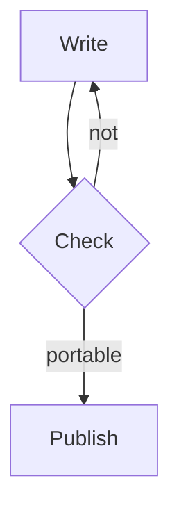

LaTeX math and Mermaid diagrams are two of the most useful extensions to Markdown, and two of the least portable. They render beautifully on some platforms and show up as raw source on others. This guide shows how to write them and where they work, so you can decide when to use them.

## Math in Markdown

Math is written in LaTeX between dollar signs. Single dollars make inline math, and double dollars make a display block on its own lines.

```md
The area of a circle is $A = \pi r^2$.

$$
\int_0^1 x^2 \, dx = \frac{1}{3}
$$
```

Math is not part of CommonMark or the original GFM specification. GitHub and Obsidian render it, and many documentation tools do too with a plugin. Plain strict-CommonMark renderers print the dollar signs and the source.

### Dollar signs that are not math

Because dollars start math, ordinary prices can be misread. Platforms use rules to avoid this, such as requiring no space just inside the dollars. If you write about money, check the result, and escape a dollar sign with a backslash when in doubt.

## Mermaid diagrams

Mermaid turns a text description into a diagram. You put it in a fenced code block with the language set to mermaid.

````md

````

Mermaid supports flowcharts, sequence diagrams, class diagrams, state diagrams, entity relationship diagrams, Gantt charts and more. GitHub and Obsidian render these blocks as diagrams. Elsewhere the block is just a code listing.

## Where each one works

| Target | Math | Mermaid |
| --- | --- | --- |
| GitHub | Yes | Yes |
| Obsidian | Yes | Yes |
| Strict CommonMark | No | No |
| Blogging platforms and site generators | Depends on the platform | Depends on the platform |

Some platforms offer their own non-standard embed tags for math or diagrams, and others need a plugin or a setting. Check the one you publish to with a test post before you rely on it. Embed tags do not work anywhere else, which is the trade-off to weigh.

## What to do when the target does not support them

- **Render an image.** Export the formula or diagram as an image and link to a hosted copy. It looks the same everywhere. Keep the source next to it so you can update it.
- **Link out.** Point to a page where the diagram renders.
- **Write it in words.** For small formulas, plain text such as x squared plus y squared can be enough.
- **Choose a different platform** if math or diagrams are central to your writing.

Always give the image alt text that explains the diagram, since screen readers cannot read it.

## Keep math and diagrams safe

Rendering user-provided math and diagrams carries some risk, since both are parsed from text. A safe renderer should not run scripts or accept HTML from the document. KaTeX can be configured to refuse unsafe commands, and Mermaid has a strict mode that sanitizes its output.

## Preview them against your target

[mdstudio](/editor) renders math with KaTeX and diagrams with Mermaid in strict mode, in light and dark themes, and only for the targets that support them. On GFM without HTML or Strict CommonMark the checker warns that math and Mermaid are not portable, and the toolbar marks the tools that target will not render. For more on compatibility, read the [portable Markdown guide](/guides/markdown-portability).
